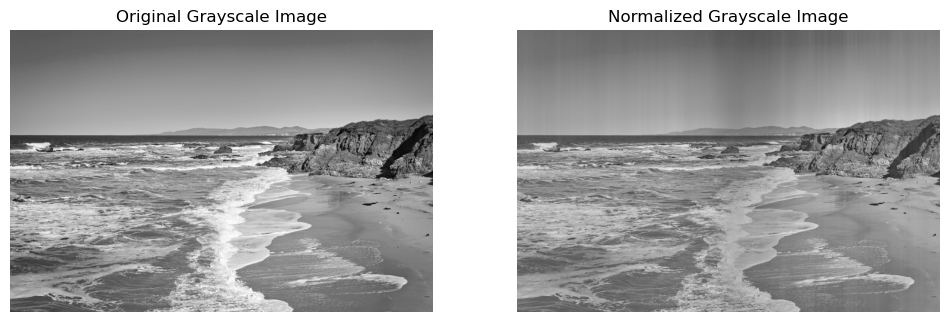
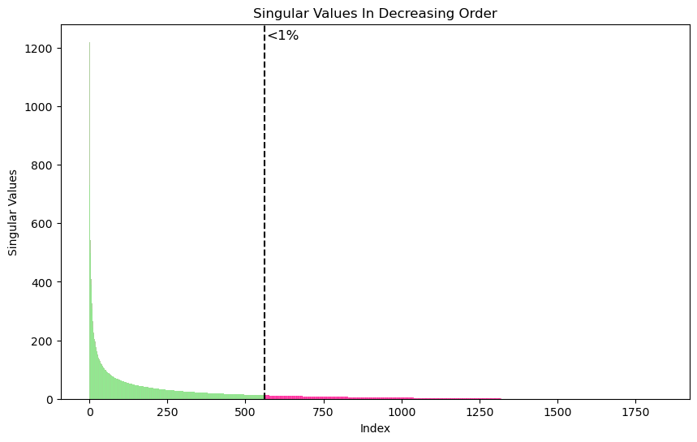
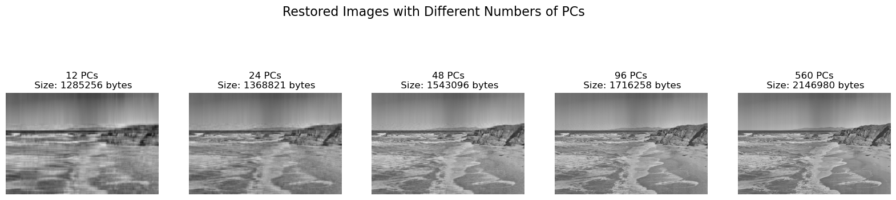

# How Few Numbers Does It Take to Keep a Photo?

**If a photo is just a big table of numbers, how much of it can be thrown away before you stop recognising the picture?**

A black-and-white photograph (1,830 pixels high) is treated as a matrix and broken down with the **singular value decomposition (SVD)**. Keeping only the strongest components gives a compressed version of the image, and the project measures how quality trades off against storage.



## Findings

- **A few components carry most of the picture.** The singular values fall off steeply: almost all of the image's structure sits in its first few hundred components, and everything after about 560 is less than 1% of the largest one.
- **12 components are already recognisable.** Rebuilding the photo from just 12 components keeps the coastline and cliffs visible while needing **about 97% less storage** than the full image.
- **Quality costs memory.** Moving from 12 to 24, 48, 96 and 560 components sharpens the image step by step. 24 components already look reasonable, but only around 560 come close to the original.

| How much each component matters | The photo rebuilt from 12, 24, 48, 96 and 560 components |
|:---:|:---:|
|  |  |

## How to run

Python with `numpy`, `pandas`, `matplotlib`, `pillow` and `scikit-learn`. Open [`image_compression_svd.ipynb`](image_compression_svd.ipynb), which is saved with all its outputs, or run the same code as a script:

```bash
pip install numpy pandas matplotlib pillow scikit-learn
python image_compression_svd.py
```

The photo is in [`data/`](data). It is a public-domain image from the US Bureau of Ocean Energy Management.

## Tools

Python · NumPy (SVD) · Pillow · Matplotlib · scikit-learn

## Background

Built in June 2024 by **Ido Shalom and Daniel Rodan** during the *Statistical Learning and Data Analysis* course at the Hebrew University of Jerusalem (B.Sc. Statistics & Data Science).
